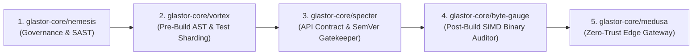

<div align="center">

# 🛡️ GLASTOR® Specter (`@glastor-core/specter`)

**Zero-Compiler Polyglot AST API Contract Differ, Trojan Breaking-Change Detector & Mathematical SemVer Gatekeeper in Rust**

[](https://github.com/glastor-core/specter/actions/workflows/audit.yml)
[](https://github.com/glastor-core/specter/actions/workflows/release.yml)
[](./LICENSE)
[](https://www.rust-lang.org/)
[](https://glastor.es)

</div>

---

## 🎯 Why `specter` Exists

Modern CI/CD pipelines blindly trust human or AI-authored commit messages (`fix:`, `chore:`, `feat:`) to determine whether a release is `PATCH`, `MINOR`, or `MAJOR`. When a developer writes `fix(gateway): clean up retry config` while changing an optional parameter `timeoutMs?: number` to required `timeoutMs: number`, traditional pipelines publish a **Trojan Breaking Change** inside a `PATCH` release—breaking downstream production systems silently.

**`glastor-core/specter`** eliminates human guesswork by mathematically extracting and comparing your repository's **Exported Public API Surface** across **Rust (`.rs`)** and **TypeScript / Deno (`.ts`, `.tsx`, `.mts`, `.js`)** in **< 5 milliseconds** without invoking `rustc` or `tsc`.

---

## 🏗️ Ecosystem Synergy (`GLASTOR® Core`)



| Stage | Repository | Role in the Pipeline |
| :--- | :--- | :--- |
| **1. Governance** | [`glastor-core/nemesis`](https://github.com/glastor-core/nemesis) | Enforces repository hygiene, secret prevention & SAST policies. |
| **2. Pre-Build AST** | [`glastor-core/vortex`](https://github.com/glastor-core/vortex) | Computes AST blast radius & shards affected test suites. |
| **3. Contract & SemVer** | **`glastor-core/specter`** | **Verifies public API surface contracts (`SHA-256`), detects Trojan Breaking Changes & dictates mathematical SemVer.** |
| **4. Post-Build Binary** | [`glastor-core/byte-gauge`](https://github.com/glastor-core/byte-gauge) | Audits compiled ELF/PE/Mach-O/Wasm binaries for entropy, checksec & size regressions. |
| **5. Edge Runtime** | [`glastor-core/medusa`](https://github.com/glastor-core/medusa) | Zero-Trust resilient API gateway & circuit-breaker edge proxy. |

---

## ⚡ Key Capabilities

1. **Zero-Compiler Polyglot Surface Extraction (`< 5 ms`)**:
   - **Rust**: Extracts `pub fn`, `pub async fn`, `pub const fn`, `pub struct` (and `pub` fields), `pub enum` (and variants), `pub trait`, `pub type`, and `pub const` while automatically ignoring `pub(crate)`, private items, and `#[cfg(test)]` modules.
   - **TypeScript / Deno**: Extracts `export function`, `export async function`, `export interface`, `export class`, `export enum`, `export type`, and `export const`, tracking optional parameters (`?`), default values (`= ...`), and rest parameters (`...args`).
2. **Cryptographic Public Surface Fingerprinting (`Contract SHA-256`)**:
   - Generates a canonical, formatting-independent `SHA-256` digest of your entire public API contract. Internal refactoring or code formatting (`cargo fmt` / `deno fmt`) never alters the fingerprint.
3. **Trojan Breaking-Change Guard (`src/commit_guard.rs`)**:
   - Cross-checks the developer's Conventional Commit (`fix:`, `feat:`, `chore:`) against the mathematical AST diff. If a `MAJOR` breaking mutation is disguised inside a non-breaking commit (without `!` or `BREAKING CHANGE:`), `specter` blocks the Pull Request immediately.
4. **SARIF 2.1.0, CycloneDX 1.5 SBOM & PR Sticky Comments**:
   - Emits inline GitHub Code Scanning annotations (`SPC001`–`SPC012`), CycloneDX 1.5 API Contract SBOMs, 14 `$GITHUB_OUTPUT` variables, and self-updating Pull Request Sticky Comments.

---

## 📋 Mathematical SemVer Contract Rules (`SPC001` – `SPC013`)

| Rule ID | SemVer Impact | Description |
| :--- | :--- | :--- |
| `SPC001` | 🔴 **MAJOR** | Exported public function, method, struct, interface, enum, trait, or type was removed. |
| `SPC002` | 🔴 **MAJOR** | New **required** parameter added to an existing exported function or method. |
| `SPC003` | 🔴 **MAJOR** | Existing parameter removed from an exported function or method. |
| `SPC004` | 🔴 **MAJOR** | Optional parameter (`x?: T` or `Option<T>`) became required (`x: T`). |
| `SPC005` | 🔴 **MAJOR** | Parameter type mutated incompatibly. |
| `SPC006` | 🔴 **MAJOR** | Function/method return type or constant/type-alias definition mutated. |
| `SPC007` | 🔴 **MAJOR** | Function/method execution model changed (`sync` ↔ `async`). |
| `SPC008` | 🔴 **MAJOR** | Public `struct`/`interface` field or `enum` variant removed. |
| `SPC009` | 🔴 **MAJOR** | Optional `interface`/`struct` field became required. |
| `SPC010` | 🔴 **MAJOR** | Public `struct`/`interface` field type mutated. |
| `SPC011` | 🟡 **MINOR** | Brand-new exported public symbol or method added. |
| `SPC012` | 🟡 **MINOR** | Backward-compatible optional parameter or field added. |
| `SPC013` | 🔴 **MAJOR** | Exported barrel re-export (`pub use` or `export { ... } from`) removed. |

---

## 🚀 Quick Start (GitHub Actions)

```yaml
- name: 🛡️ Audit Public API Contract & SemVer with GLASTOR® Specter
  id: specter
  uses: glastor-core/specter@v1
  with:
    head-dir: "."
    base-ref: "origin/main"
    fail-on-trojan: "true"
    output-json: ".specter/audit.json"
    output-sarif: ".specter/specter.sarif"
    output-sbom: ".specter/specter.cdx.json"
```

### CLI Usage

```bash
# Compare two directories or branches and verify Conventional Commit alignment
specter \
  --base-dir ./baseline-src \
  --head-dir ./src \
  --commit-message "fix(gateway): adjust retry options" \
  --fail-on-trojan \
  --output-json .specter/report.json \
  --output-sarif .specter/specter.sarif \
  --output-sbom .specter/specter.cdx.json
```

---

## 📄 License & Corporate Governance

Licensed under the [MIT License](./LICENSE).
Maintained by **Andrés Antonio Cardoso — GLASTOR® Core (@glastor-dev)** — [https://glastor.es](https://glastor.es) (`ventas@glastor.es`).

