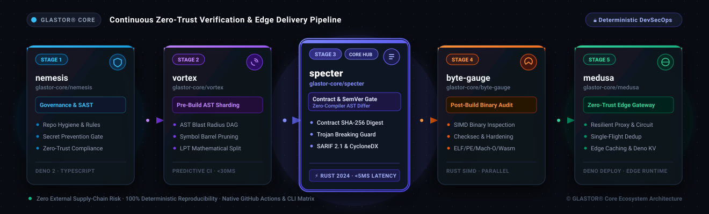

<div align="center">

# 🛡 GLASTOR® Specter (`@glastor-core/specter`)

**Zero-Compiler Polyglot AST API Contract Differ, Trojan Breaking-Change Detector & Mathematical SemVer Gatekeeper in Rust**

<p align="center">
  
</p>

[](https://specter.glastor.es)
[-10b981?style=flat-square)](./ROADMAP.md)
[](https://github.com/marketplace/actions/glastor-specter-polyglot-ast-api-contract-semver-gatekeeper)
[](https://github.com/glastor-core/specter/actions/workflows/audit.yml)
[](https://crates.io/crates/specter-cli)
[](https://crates.io/crates/specter-cli)
[](https://github.com/glastor-core/homebrew-tap)
[](https://github.com/glastor-core/specter/actions/workflows/release.yml)
[](./LICENSE)
[](https://www.rust-lang.org/)
[](https://glastor.es)
<br>
[](https://codespaces.new/glastor-core/specter)
[](https://github.com/glastor-core/specter/watchers)
[](https://github.com/glastor-core/specter/fork)
[](https://github.com/glastor-core/specter)
[](https://github.com/glastor-dev)

</div>

---

<p align="center">
  
</p>

## 🎯 Why `specter` Exists

Modern CI/CD pipelines blindly trust human or AI-authored commit messages (`fix:`, `chore:`, `feat:`) to determine whether a release is `PATCH`, `MINOR`, or `MAJOR`. When a developer writes `fix(gateway): clean up retry config` while changing an optional parameter `timeoutMs?: number` to required `timeoutMs: number`, traditional pipelines publish a **Trojan Breaking Change** inside a `PATCH` release—breaking downstream production systems silently.

**`glastor-core/specter`** eliminates human guesswork by mathematically extracting and comparing your repository's **Exported Public API Surface** across **Rust (`.rs`)** and **TypeScript / Deno (`.ts`, `.tsx`, `.mts`, `.js`)** in **< 5 milliseconds** without invoking `rustc` or `tsc`.

---

## 🏗 Ecosystem Synergy (`GLASTOR® Core`)

<p align="center">
  
</p>

| Stage | Repository | Role in the Pipeline |
| :--- | :--- | :--- |
| **1. Governance** | [`glastor-core/nemesis`](https://github.com/glastor-core/nemesis) | Enforces repository hygiene, secret prevention & SAST policies. |
| **2. Pre-Build AST** | [`glastor-core/vortex`](https://github.com/glastor-core/vortex) | Computes AST blast radius & shards affected test suites. |
| **3. Contract & SemVer** | **`glastor-core/specter`** | **Verifies public API surface contracts (`SHA-256`), detects Trojan Breaking Changes & dictates mathematical SemVer.** |
| **4. Post-Build Binary** | [`glastor-core/byte-gauge`](https://github.com/glastor-core/byte-gauge) | Audits compiled ELF/PE/Mach-O/Wasm binaries for entropy, checksec & size regressions. |
| **5. Edge Runtime** | [`glastor-core/medusa`](https://github.com/glastor-core/medusa) | Zero-Trust resilient API gateway & circuit-breaker edge proxy. |

---

## ⚡ Key Capabilities (`v1.0.0`)

1. **Zero-Compiler Official AST Extraction (`syn 3` + `oxc_parser`)**:
   - **Rust 2024 (`syn`)**: Parses the full official Rust grammar without invoking `rustc`—handling `pub fn`, `pub async fn`, `pub const fn`, `impl` methods, `pub struct`, `pub enum`, `#[non_exhaustive]`, `#[doc(hidden)]`, `pub(crate)`/`pub(super)`, `where` clauses, attributes (`#[serde(...)]`), and `#[cfg(test)]` anywhere in the file.
   - **TypeScript / JS / Deno (`oxc_parser`)**: Sub-millisecond Rust AST resolving `export function`, exported arrow functions (`export const fn = (...) => ...`), classes, decorators, interfaces, enums, JSDoc `@internal`/`@private`, barrel re-exports, union normalization (`A | B == B | A`, `Array<T> == T[]`), and basic type variance (contravariant param widening → `MINOR`, covariant return narrowing → `PATCH`).
2. **Entry-Point Reachability & Logical Symbol IDs (`src/reachability.rs`)**:
   - Auto-discovers `Cargo.toml` (`[lib]` & `[workspace]`), `src/lib.rs`, `package.json` (`exports`/`main`), and `deno.json` (`exports`). Identifies symbols by their exported logical path (`crate::Client::send`, `pkg::Client::send`) so moving internal files behind `pub use` or barrel re-exports produces **zero false `SPC001`**.
3. **Enterprise Config (`specter.toml`) & Auditable Inline Suppressions**:
   - Configure `entry_points`, `ignore_paths`, `ignore_symbols`, `ignore_rules`, `strict_minor`, and per-rule `[rule_severity]` overrides, or suppress individual changes inline with mandatory PR reason: `// specter-ignore: SPC005 -- RFC-42 migration`.
4. **0% False-Positive Golden Gate & Trojan Breaking-Change Guard**:
   - Verified by a **105-case Golden Regression Suite (0.00% FPR)** and cross-checked against Conventional Commits (`fix:`, `feat:`, `chore:`) to block disguised `MAJOR` breaking changes.
5. **SARIF 2.1.0, CycloneDX 1.5 SBOM & PR Sticky Comments**:
   - Emits inline GitHub Code Scanning annotations (`SPC001`–`SPC013`), CycloneDX 1.5 API Contract SBOMs, 14 `$GITHUB_OUTPUT` variables, and self-updating Pull Request Sticky Comments. See [ROADMAP.md](./ROADMAP.md) for v1.0 metrics and Post-1.0 Go/Python expansion.

---

## ⚔ Architectural Comparison: Specter vs Compiler-Dependent Tools

Traditional contract tools depend on heavyweight compilation phases (`rustdoc JSON` or `tsc --emitDeclarationOnly`). In CI/CD pipelines, this means downloading large toolchains, compiling hundreds of transitive dependencies, and burning minutes of billable runner time on every Pull Request.

**Specter** bypasses compilers completely, analyzing raw AST syntax and Git object streams in **< 5 milliseconds**.

| Capability / Metric | 🛡 **GLASTOR® Specter** | `cargo-semver-checks` | `@microsoft/api-extractor` | Conventional Commits Alone |
| :--- | :---: | :---: | :---: | :---: |
| **Execution Latency** | ⚡ **< 5 ms** (Zero-Compiler) | ⏳ 2 – 8 minutes | ⏳ 30s – 2 minutes | 0 ms (Manual) |
| **Compiler Requirement** | ❌ **None** (No `rustc` / `tsc`) | ⚠ Requires `rustdoc` JSON | ⚠ Requires full `tsc` compile | ❌ None |
| **Polyglot Monorepo Support** | 🦀 **Rust + 🦕 TS / JS / Deno** | 🦀 Rust only | 🟦 TypeScript only | N/A |
| **Trojan Breaking-Change Guard** | ✅ **Automated Mathematical Check** | ❌ No commit intent check | ❌ No commit intent check | ❌ Blind human trust |
| **Zero-Disk Git Extraction** | ✅ In-memory (`git show` stream) | ❌ Full disk build required | ❌ Full disk build required | ❌ N/A |
| **PR Sticky Comments & Migration** | ✅ Automated Markdown + Diff Guide | ❌ Text / CLI only | ❌ Markdown report only | ❌ N/A |
| **Security & SBOM Compliance** | ✅ **SARIF 2.1.0 + CycloneDX 1.5** | ❌ Custom JSON only | ❌ Custom doc model only | ❌ None |
| **FinOps CI Minute Cost** | 🟢 **~$0.00** (< 5ms runner time) | 🔴 High CI minute cost | 🟡 Moderate CI minute cost | 🟢 $0 |
| **Supply-Chain Attack Surface** | 🛡 **Zero External Dependencies** | ⚠ Multiple cargo plugins | ⚠ 50+ npm dependencies | ❌ Vulnerable to deception |

---

## 📋 Mathematical SemVer Contract Rules (`SPC001` – `SPC013`)

| Rule ID | SemVer Impact | Description |
| :--- | :--- | :--- |
| `SPC001` | 🔴 **MAJOR** | Exported public function, method, struct, interface, enum, trait, or type was removed. |
| `SPC002` | 🔴 **MAJOR** | New **required** parameter added to an existing exported function or method. |
| `SPC003` | 🔴 **MAJOR** | Existing parameter removed from an exported function or method. |
| `SPC004` | 🔴 **MAJOR** | Optional parameter (`x?: T` or `Option<T>`) became required (`x: T`). |
| `SPC005` | 🔴 **MAJOR** | Parameter type mutated incompatibly. |
| `SPC006` | 🔴 **MAJOR** | Function/method return type or constant/type-alias definition mutated. |
| `SPC007` | 🔴 **MAJOR** | Function/method execution model changed (`sync` ↔ `async`). |
| `SPC008` | 🔴 **MAJOR** | Public `struct`/`interface` field or `enum` variant removed. |
| `SPC009` | 🔴 **MAJOR** | Optional `interface`/`struct` field became required. |
| `SPC010` | 🔴 **MAJOR** | Public `struct`/`interface` field type mutated. |
| `SPC011` | 🟡 **MINOR** | Brand-new exported public symbol or method added. |
| `SPC012` | 🟡 **MINOR** | Backward-compatible optional parameter or field added. |
| `SPC013` | 🔴 **MAJOR** | Exported barrel re-export (`pub use` or `export { ... } from`) removed. |

---

## 🚀 Quick Start (GitHub Actions)

### ⚡ 5-Line Plug & Play (Minimal Copy-Paste)

Add this single step to any Pull Request workflow (`.github/workflows/ci.yml`). It runs in **< 5 ms** without requiring compiler setup:

```yaml
- name: 🛡 Audit API Contract & SemVer Gate
  uses: glastor-core/specter@v1
  with:
    base-ref: ${{ github.base_ref || 'origin/main' }}
    fail-on-trojan: "true"
```

---

### 🛡 Full Enterprise Pipeline (SARIF 2.1.0 + CycloneDX 1.5 SBOM)

For complete integration with GitHub Code Scanning alerts, SBOM artifacts, and full JSON audit telemetry:

```yaml
- name: 🛡 Audit Public API Contract & SemVer with GLASTOR® Specter
  id: specter
  uses: glastor-core/specter@v1
  with:
    head-dir: "."
    base-ref: "origin/main"
    fail-on-trojan: "true"
    output-json: ".specter/audit.json"
    output-sarif: ".specter/specter.sarif"
    output-sbom: ".specter/specter.cdx.json"
```

### CLI Usage

```bash
# Compare two directories or branches and verify Conventional Commit alignment
specter \
  --base-dir ./baseline-src \
  --head-dir ./src \
  --commit-message "fix(gateway): adjust retry options" \
  --fail-on-trojan \
  --output-json .specter/report.json \
  --output-sarif .specter/specter.sarif \
  --output-sbom .specter/specter.cdx.json
```

---

## 🏅 Official Status Badge (Add to Your README)

Show the community that your public API contract and SemVer releases are mathematically verified by **GLASTOR® Specter**. Copy and paste this snippet into your repository's `README.md`:

[](https://github.com/glastor-core/specter)

```markdown
[](https://github.com/glastor-core/specter)
```

---

## 🤝 Contributing & Good First Issues

Looking to contribute to AST static analysis, compiler tooling, or Rust 2024 diagnostics?

1. **[Fork this repository](https://github.com/glastor-core/specter/fork)** or launch it directly in [GitHub Codespaces](https://codespaces.new/glastor-core/specter).
2. Explore our open beginner-friendly tasks under [Issue #11](https://github.com/glastor-core/specter/issues/11) (`good first issue`).
3. Run the test suite:
   ```bash
   cargo test
   ```
4. Submit your Pull Request!

> 🔔 **Stay Updated on Linter & Security Rules**: Click **Watch** (top-right) and select **Custom ➔ Releases** to get notified of new SARIF integrations, Homebrew releases, and SemVer checks.

---

## ⭐ Star History

<div align="center">

[](https://star-history.com/#glastor-core/specter&Date)

*If you find Specter useful, please consider starring the repository and following [@glastor-dev](https://github.com/glastor-dev) on GitHub!*

</div>

---

## 📄 License & Corporate Governance

Licensed under the [MIT License](./LICENSE).

© 2010–2026 [GLASTOR®](https://glastor.es/) (INPI Reg. 4559568 & 4559567) • Dual-Hub Operations (Spain & Argentina · Factura E) • Led by [@glastor-dev](https://github.com/glastor-dev) (GitHub Developer Program Member).

